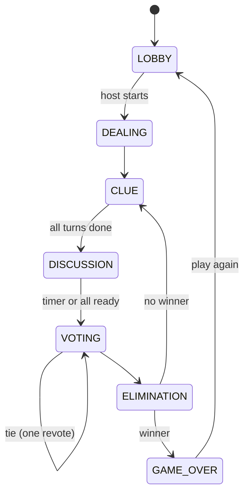

# Who's the Impostor? — Build Spec and Roadmap

Put this file at `docs/PLAN.md`. It's the source of truth for game rules, architecture and build order.

## 1. Product decisions

| Decision | Choice |
| --- | --- |
| Room size | 3–8 players |
| Impostors | 1 by default; host may choose 2 when there are 7–8 players |
| Impostor's word | Related decoy word (e.g., crew gets "Adobo", impostor gets "Sinigang"). The impostor is not told their role |
| Login | Guest with nickname; optional Google login for match history and stats |
| Clues | Spoken on camera, then typed (max 5 words) into a shared clue log |
| Video | Everyone on camera in a grid, like a group call |
| Target devices | Mobile-first (most players on phones and mobile data) |

## 2. Game rules

### Setup
- Host picks a theme and settings in the lobby, then starts.
- Server picks an unused word pair from the theme, randomly decides which word goes to the crew, picks impostor(s) at random, and deals each player only their own word.

### Round loop
1. **CLUE**: random turn order. Active player has ~30 s to speak, then submits a typed clue (≤ 5 words, must not contain their word, case-insensitive). Timeout = skipped turn.
2. **DISCUSSION**: ~90 s. Ends early if every alive player presses "Ready to vote".
3. **VOTING**: ~30 s. Secret votes. No self-votes. Skip allowed. Only alive players vote. Results revealed when all have voted or time runs out.
4. **ELIMINATION**: most votes is out; their role (CREW/IMPOSTOR) is revealed, not their word. Eliminated players become spectators: camera on, mic muted, no vote, no clues.
5. Check win conditions; if no winner, start the next round's CLUE phase.

### Win conditions
- Crew wins when all impostors are eliminated.
- Impostors win when alive impostors ≥ alive crew.
- Optional setting `lastGuess`: an eliminated impostor may type a guess of the crew word. Correct guess means impostors win.

### Timers
Host-configurable (clue, discussion, voting seconds). Defaults: 30 / 90 / 30.

### Edge cases

| Situation | Rule |
| --- | --- |
| Tie | One 20 s revote between tied players only. Still tied = nobody out this round |
| Everyone skips | Nobody out; next round |
| Player disconnects mid-game | Seat held 60 s. Their clue turn is skipped; vote counts as skip. After 60 s they're eliminated and role revealed |
| Last impostor disconnects for good | Crew wins ("Impostor left the game") |
| Host disconnects | Host passes to longest-connected player; game continues |
| Late joiner | Joins as spectator; gets a seat next game |
| Fewer than 3 players | Game ends with result ABANDONED; back to lobby |
| Page refresh | Rejoin with reconnect token; server re-sends their private card |

### State machine



## 3. Architecture

```
Browser (each player)
  ├─ HTTPS ──────────► Next.js on Vercel: pages, Auth.js, signs game-server JWT ──► Postgres
  ├─ WebSocket ◄─────► Game server on Render: Socket.IO + engine, timers, private words,
  │                     mints LiveKit tokens, kicks via LiveKit server API ─────────► Postgres
  └─ WebRTC video ◄──► LiveKit Cloud (SFU, TURN built in)
```

- Game state lives in memory on the game server (one engine instance per room). Write to Postgres at the end of each round and at game over.
- Don't host the Socket.IO server on Vercel (WebSocket support there is beta with a 5-minute default duration cap).
- Auth flow: Next.js issues a ~15-minute signed JWT `{ playerId, displayName, userId? }`. Game server verifies it on connect.
- LiveKit tokens are minted by the game server only after the player has joined the game room; scoped to that room and identity.

### Shared types (`packages/shared`)

```ts
export type Phase = 'LOBBY' | 'DEALING' | 'CLUE' | 'DISCUSSION' | 'VOTING' | 'ELIMINATION' | 'GAME_OVER';
export type Role = 'CREW' | 'IMPOSTOR';

export interface RoomSettings {
  themeId: string | null;
  impostorCount: 1 | 2;
  clueSeconds: number;
  discussionSeconds: number;
  votingSeconds: number;
  lastGuess: boolean;
}

// Broadcast to everyone in the room
export interface PublicRoomState {
  code: string;
  phase: Phase;
  hostId: string;
  settings: RoomSettings;
  round: number;
  players: {
    id: string;
    name: string;
    alive: boolean;
    connected: boolean;
    revealedRole?: Role;
  }[];
  activePlayerId?: string;
  clues: { playerId: string; round: number; text: string }[];
  phaseEndsAt?: number;     // server epoch ms
  votesCast?: number;       // count only
  result?: { winner: 'CREW' | 'IMPOSTOR'; roles: Record<string, Role>; crewWord: string; decoyWord: string };
}

// Sent only to one socket
export interface PrivateCard { word: string }
```

### Socket events

| Client → server | Server → client |
| --- | --- |
| `room:create`, `room:join`, `room:leave` | `room:state` (PublicRoomState) |
| `game:settings`, `game:start` (host only) | `card:deal` (PrivateCard, to one socket) |
| `clue:submit` | `phase:change` |
| `discussion:ready` | `vote:result`, `player:eliminated` |
| `vote:cast` | `game:over` |
| `impostor:lastGuess` | `livekit:token` |
| `host:kick`, `host:lock` | `error` |

Send the full `room:state` after every change (not diffs).

## 4. Word system

- Curated `WordPair` rows per theme, used for all live games. AI may be used only offline to draft pairs, which start `approved = false` and need review in an admin page.
- Good pairs: same category and similar commonness, different in 1–2 clear ways (Adobo/Sinigang, Jeepney/Tricycle, Boracay/Siargao, Basketball/Volleyball, Teacher/Principal, Beach/Swimming pool). Not synonyms, not unrelated.
- Randomly choose which word of the pair is the crew word.
- No repeats: each room tracks used pair IDs and draws only unused approved pairs; reset and shuffle when the theme is exhausted. Signed-in players also skip their last 50 pairs where possible.
- Seed themes: Food, Places in the Philippines, Animals, Jobs, Sports, School Life, Things at Home, Pinoy Pop Culture. Seed 15 pairs per theme in Phase 0; grow to 30+ in Phase 4.
- Fields: `language` (en / tl / taglish), `difficulty` (EASY / MEDIUM / HARD).

## 5. Database (Prisma)

Auth.js adds `Account`, `Session`, `VerificationToken`.

```prisma
enum Role { CREW IMPOSTOR }
enum Difficulty { EASY MEDIUM HARD }
enum MatchResult { CREW_WIN IMPOSTOR_WIN ABANDONED }

model User {
  id        String   @id @default(cuid())
  name      String?
  email     String?  @unique
  image     String?
  players   Player[]
  createdAt DateTime @default(now())
}

model Player {
  id          String        @id @default(cuid())
  displayName String
  userId      String?
  user        User?         @relation(fields: [userId], references: [id])
  matches     MatchPlayer[]
  createdAt   DateTime      @default(now())
}

model Theme {
  id       String     @id @default(cuid())
  slug     String     @unique
  name     String
  isActive Boolean    @default(true)
  pairs    WordPair[]
}

model WordPair {
  id         String     @id @default(cuid())
  themeId    String
  theme      Theme      @relation(fields: [themeId], references: [id])
  wordA      String
  wordB      String
  language   String     @default("en")
  difficulty Difficulty @default(MEDIUM)
  approved   Boolean    @default(false)
  matches    Match[]
  @@unique([themeId, wordA, wordB])
}

model Room {
  id        String    @id @default(cuid())
  code      String    @unique
  hostId    String
  settings  Json
  matches   Match[]
  createdAt DateTime  @default(now())
  closedAt  DateTime?
}

model Match {
  id        String        @id @default(cuid())
  roomId    String
  room      Room          @relation(fields: [roomId], references: [id])
  pairId    String
  pair      WordPair      @relation(fields: [pairId], references: [id])
  crewWord  String
  decoyWord String
  result    MatchResult?
  players   MatchPlayer[]
  rounds    Round[]
  startedAt DateTime      @default(now())
  endedAt   DateTime?
}

model MatchPlayer {
  id           String  @id @default(cuid())
  matchId      String
  match        Match   @relation(fields: [matchId], references: [id])
  playerId     String
  player       Player  @relation(fields: [playerId], references: [id])
  role         Role
  eliminatedIn Int?
  won          Boolean @default(false)
  @@unique([matchId, playerId])
}

model Round {
  id         String  @id @default(cuid())
  matchId    String
  match      Match   @relation(fields: [matchId], references: [id])
  number     Int
  clues      Clue[]
  votes      Vote[]
  eliminated String?
  @@unique([matchId, number])
}

model Clue {
  id        String   @id @default(cuid())
  roundId   String
  round     Round    @relation(fields: [roundId], references: [id])
  playerId  String
  text      String
  createdAt DateTime @default(now())
}

model Vote {
  id       String  @id @default(cuid())
  roundId  String
  round    Round   @relation(fields: [roundId], references: [id])
  voterId  String
  targetId String?          // null = skip
  @@unique([roundId, voterId])
}
```

## 6. Screens

| Screen | Contents |
| --- | --- |
| Landing | Create room, Join with code, 3-step how-to-play, "waking the server" state |
| Join / create | Nickname, optional Google sign-in, camera + mic preview and device picker |
| Lobby | Video grid, room code with copy/share, host settings (theme cards, impostor count, timers, last guess), Ready toggles |
| Word reveal | Full-screen card flip "Your word: X"; tap-and-hold to peek later |
| Clue round | Active speaker tile enlarged + outlined, countdown ring, clue input on your turn, clue log panel (bottom sheet on mobile) |
| Discussion | Equal grid, clue log grouped by player, timer, "Ready to vote" |
| Voting | Tap a tile to vote, Skip button, votes-cast count, animated reveal |
| Elimination | Tile greys out with CREWMATE / IMPOSTOR stamp; "Spectating" badge |
| Game over | Winner banner, all roles, both words side by side, clue recap, Play again (same room and call) |
| Profile | Games played, wins as crew / impostor, recent matches (signed-in only) |

Layout: 2×2 grid up to 4 players, 3×3 for 5–8; on phones, the active speaker goes on top with the others in a row underneath. Word card in a fixed corner. Video defaults to 360p; camera-off shows an avatar tile. One accent colour for "your turn" / active speaker; red only for eliminations.

## 7. Security checklist

- [ ] Words sent only via `io.to(socketId)`; a test asserts `PublicRoomState` has no words or roles before reveal
- [ ] JWT verified on socket connect; reject unknown or expired tokens
- [ ] LiveKit tokens minted server-side, room + identity scoped, only for seated players
- [ ] Vote validation: correct phase, voter alive, not self, one per round (plus DB unique constraint)
- [ ] `clue:submit` only from the active player during CLUE
- [ ] zod validation on every incoming event; per-socket rate limit (~10 events/s); max clue length
- [ ] Room codes: 6 characters from `ABCDEFGHJKMNPQRSTUVWXYZ23456789`; rate-limit joins per IP
- [ ] Nickname and clue word filter (English + Tagalog list)
- [ ] Reconnect token in `sessionStorage`, bound to one seat
- [ ] Host controls: kick (also removes from LiveKit room), lock room, edit settings in lobby, restart

## 8. Roadmap

Video only starts after a text-only game works in 4 browser tabs.

### Phase 0: Setup (week 1)
- [ ] pnpm monorepo with `apps/web`, `apps/game-server`, `packages/shared`, `packages/engine`
- [ ] ESLint, Prettier, strict TypeScript, Vitest wired up across workspaces
- [ ] Prisma schema + first migration; seed script with 3 themes × 15 approved pairs
- [ ] GitHub Actions: lint, typecheck, test on push and PR
- [ ] `.env.example` with every variable
- **Done when:** `pnpm lint && pnpm typecheck && pnpm test` passes in CI.

### Phase 1: Game engine, no network (weeks 2–3)
- [ ] `packages/engine`: reducer `(state, action, rng) => state` covering every rule in section 2
- [ ] Unit tests: dealing (impostor gets decoy, counts correct), turn order, clue validation, discussion early end, votes, tie + revote, skip, elimination reveal, both win conditions, last guess, disconnect hold + timeout, host handover, < 3 players
- [ ] `toPublicState(state)` and `toPrivateCard(state, playerId)` selectors, with a leak test
- [ ] Local hot-seat page in `apps/web` (`/dev/hotseat`) to click through a full game
- **Done when:** every rule in section 2 has a passing test.

### Phase 2: Real-time rooms (weeks 4–6)
- [ ] Socket.IO server hosting one engine per room; server-side phase timers
- [ ] Create/join by code, lobby, host settings, ready toggles
- [ ] Private card dealing, clue log, voting, elimination, game over, play again
- [ ] Auth.js Google + guest sessions; JWT for the game server; reconnect on refresh
- [ ] Persist Match / Round / Clue / Vote / MatchPlayer at round end and game over
- **Done when:** 4 browser tabs complete a full text-only game, including a refresh mid-game.

### Phase 3: Video (weeks 7–8)
- [ ] `livekit:token` minted by the game server; grid with LiveKit React components
- [ ] Active-speaker outline on the clue turn; mic/camera toggles; eliminated players muted server-side
- [ ] Device picker on join; 360p default; camera-off avatar
- **Done when:** 4 people finish a real game on their phones.

### Phase 4: Polish (weeks 9–10)
- [ ] Card flip, vote reveal and elimination animations (Framer Motion); sound effects with a mute toggle
- [ ] Mobile layouts for every screen
- [ ] Profile + stats page
- [ ] Admin page to review AI-drafted pairs; 30+ approved pairs per theme

### Phase 5: Deploy, test, present (weeks 11–12)
- [ ] Deploy: web → Vercel, game server → Render, DB → Neon or Supabase (not Render's free Postgres, which expires after 30 days)
- [ ] "Waking the server" screen for Render cold starts (~1 min after 15 min idle)
- [ ] Playwright e2e: 4 browser contexts play one full game
- [ ] README: live demo link, demo GIF/video, architecture diagram, "How roles stay secret", test badge, "What I'd do next"

## 9. Out of scope until Phase 5 ships

Custom themes, in-game text chat, spectator share links, leaderboards, Flutter/PWA client, self-hosted LiveKit.

## 10. Known risks

| Risk | Mitigation |
| --- | --- |
| WebRTC fails on strict NATs | LiveKit handles TURN; test on mobile data and campus Wi-Fi in Phase 3 |
| State drift between clients | Server-only state; full state broadcast after each change |
| Timer drift | Server owns timers; clients render from `phaseEndsAt` |
| LiveKit free minutes (5,000 participant-min/month) run out | Disconnect video after 10 min idle in lobby; Daily (10,000 free min) as backup |
| Render cold start on demo day | Open the app beforehand, or upgrade to a paid instance during interviews |
| Bad word pairs | "Report pair" button; playtest each theme |
